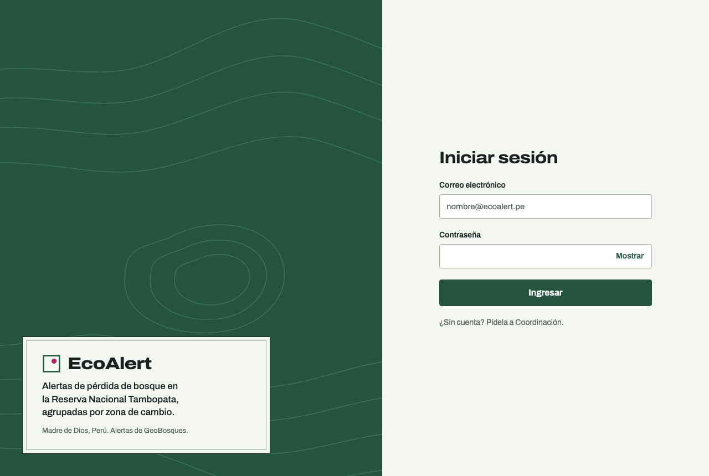
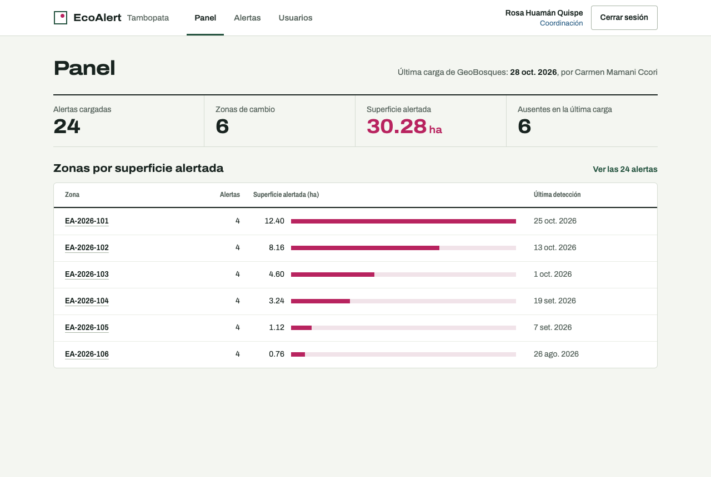
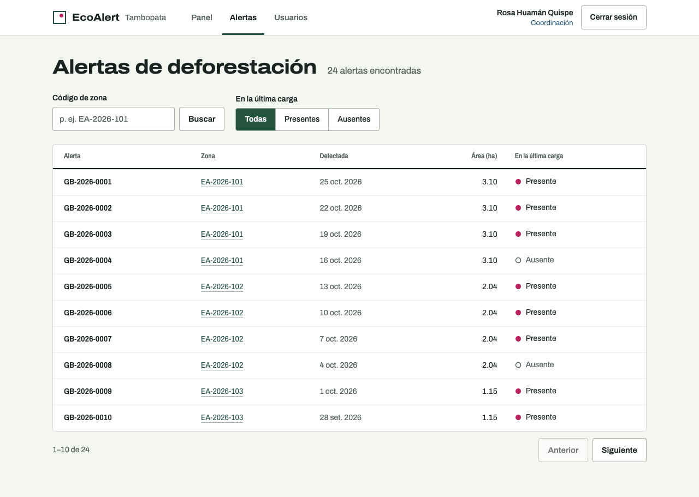
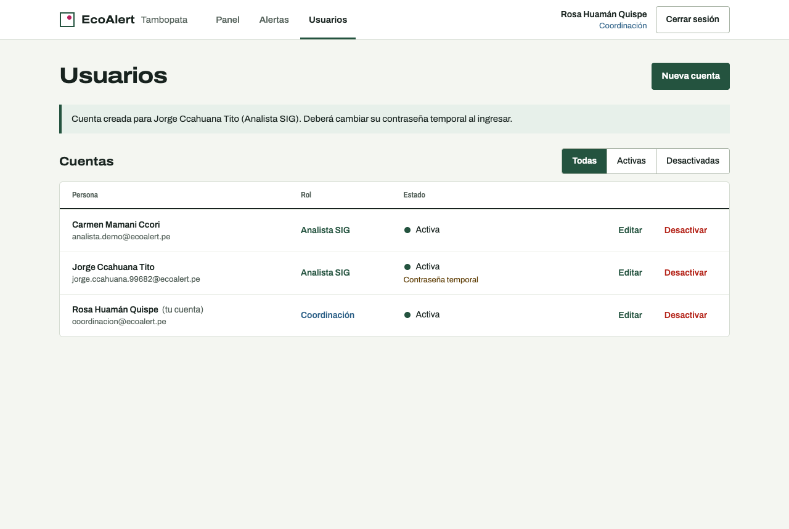
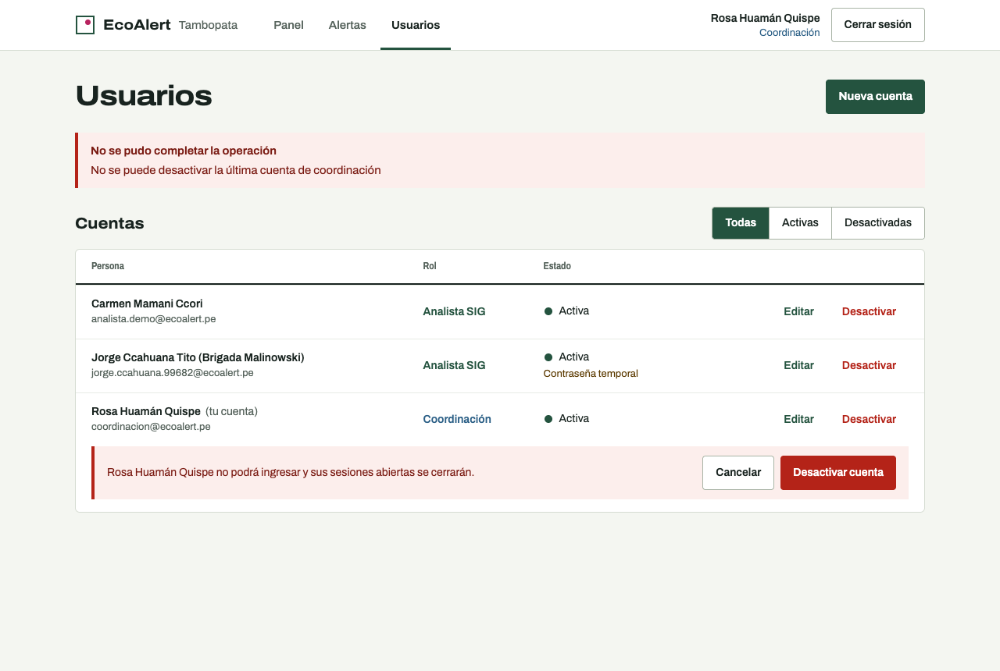
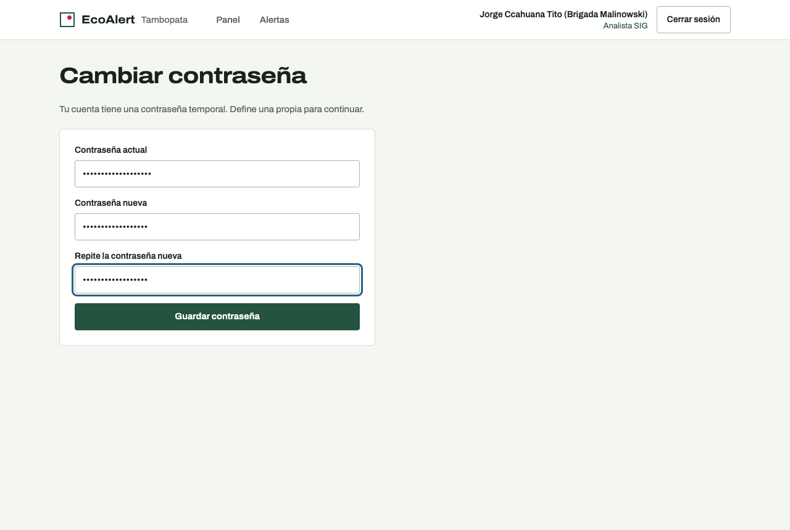
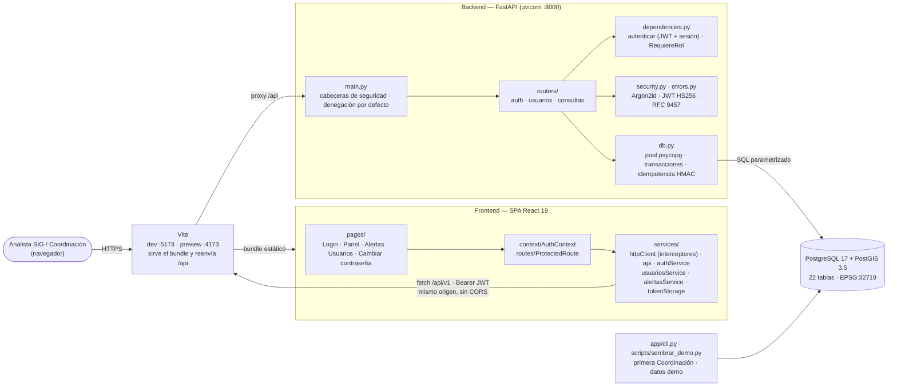

# EcoAlert Tambopata

Aplicación web de apoyo al monitoreo de la pérdida de cobertura forestal en la **Reserva Nacional Tambopata** y su
zona de amortiguamiento (Madre de Dios, Perú). Proyecto del **Equipo 6** de TC5062 *Análisis, diseño y construcción de
software* (Gpo 10).

| | |
|---|---|
| **Aplicación en producción** | <https://ecoalert-s11-demo-9657g5g67gjq3pgww-4173.app.github.dev> (GitHub Codespace; ver [Despliegue](#8-despliegue)) |
| **Contrato de la API** | [`backend/docs/openapi_integrado.yaml`](backend/docs/openapi_integrado.yaml) (OpenAPI 3.0, v1.3.0) |
| **Requerimientos** | [`S03_A1/SRS_equipo.md`](S03_A1/SRS_equipo.md) (IEEE 830, línea base v1.0) · [backlog](S03_A1/backlog_completo.md) |
| **Estado y trazabilidad** | [`S11_A1/matriz_trazabilidad.md`](S11_A1/matriz_trazabilidad.md) · [retrospectiva](S11_A1/retrospectiva_proyecto.md) |

---

## 1. Problema y valor

Las alertas oficiales de pérdida de bosque (GeoBosques, y como mejora RADD) llegan por cientos y con 1 a 4 semanas de
desfase. Para decidir **qué zona revisar primero y por qué**, el analista SIG tiene que cruzar cada alerta con el límite
de la reserva, la zona de amortiguamiento, el catastro minero y los ríos, comparar periodos y documentar su revisión, en
varias herramientas distintas y sin un registro común de lo que ya se revisó.

EcoAlert propone una sola aplicación que agrupa las alertas en **zonas de cambio**, les asigna una **prioridad de 0 a 100
con su desglose visible**, registra el **estado y el historial** de cada revisión y deja la decisión final al
especialista: el sistema **no determina causas ni legalidad** y no emite alertas oficiales (RD-02, RD-05 del SRS).

**Usuarios** (dos roles, SRS §2.3):

| Rol | Qué hace en el sistema |
|---|---|
| **Analista SIG** | Trabajo operativo: carga datos, revisa zonas, cambia estados, ajusta prioridades y exporta. No programa. |
| **Coordinación** | Consulta todo y **administra las cuentas**. No modifica datos de zonas. |

### Qué entrega hoy esta versión

El incremento construido cubre la **base sobre la que se apoya todo lo demás**: acceso seguro, administración de cuentas
y consulta de alertas.

- **Inicio de sesión con JWT** y sesión de servidor que expira tras 30 min de inactividad, se revoca al cerrar sesión y
  al desactivar la cuenta (RF-01).
- **Gestión de usuarios** completa para Coordinación: alta con contraseña temporal, edición de nombre y rol,
  desactivación/reactivación (las cuentas no se borran) y cambio obligatorio de la contraseña temporal (RF-02).
- **Consulta de alertas** de GeoBosques paginada y filtrable, y lectura de cargas, marcas, ajustes e historial de zonas
  (parte de lectura de RF-04, RF-11, RF-12 y RF-13).
- Control de acceso **en el servidor** (401/403) en todas las rutas, según la matriz de permisos del SRS (RNF-01, RNF-02).

**Todavía no está construido** el núcleo geoespacial: ingesta de archivos, agrupación en zonas, mapa, cálculo de
prioridad, comparación de periodos y exportación. Las alertas y zonas que se ven en la demo vienen de la semilla de
demostración (`backend/scripts/sembrar_demo.py`). El detalle por requerimiento está en la
[matriz de trazabilidad](S11_A1/matriz_trazabilidad.md).

## 2. Capturas

| | |
|---|---|
|  **Inicio de sesión** — toda ruta protegida sin sesión redirige aquí. |  **Panel** — cifras y zonas ordenadas por superficie alertada, calculadas con las alertas cargadas. |
|  **Alertas** — 24 alertas de GeoBosques desde PostGIS, con filtros y paginación. |  **Gestión de usuarios** — alta de una cuenta de Analista SIG. |
|  **Error manejado** — el servidor impide desactivar la última cuenta de Coordinación (409). |  **Primer ingreso** — la cuenta nueva debe reemplazar su contraseña temporal. |

Las capturas se generaron con la prueba E2E [`S11_A1/evidencias/flujo_e2e.cjs`](S11_A1/evidencias/flujo_e2e.cjs) sobre
el sistema real (Vite + FastAPI + PostGIS).

## 3. Arquitectura



**Cómo fluye una petición.** El navegador solo habla con un origen: Vite sirve la SPA y reenvía `/api` a FastAPI (en
producción haría lo mismo Nginx), así que el backend no necesita CORS. La SPA guarda el JWT en `sessionStorage` y el
interceptor de `services/api.js` lo agrega como `Authorization: Bearer`; un 401 en cualquier llamada cierra la sesión en
toda la aplicación. En el servidor, `autenticar` valida firma, emisor, audiencia y expiración del token, **y además** que
la sesión (`jti`) siga abierta, que no lleve más de 30 min inactiva y que la cuenta siga activa; `RequiereRol` aplica la
matriz de permisos. Las reglas de negocio viven en los routers, que usan SQL parametrizado dentro de transacciones. Los
errores salen como `application/problem+json` (RFC 9457) con un `mensaje` en español que la SPA muestra tal cual.

**Decisiones de arquitectura principales** (justificación completa en los documentos de cada semana):

| Decisión | Alternativa descartada | Por qué | Dónde |
|---|---|---|---|
| Contrato OpenAPI primero; pruebas que verifican que cada ruta montada está en el contrato | Documentar la API después del código | El contrato es la fuente de verdad compartida entre backend y frontend (SWEBOK v4, KA04 *Software Construction*, «API Design and Use») | `backend/tests/test_contrato.py` |
| JWT **más** sesión en base de datos (`jti` revocable, inactividad de 30 min) | JWT puramente sin estado | Un JWT sin estado no se puede revocar al cerrar sesión ni al desactivar la cuenta (RF-01-AC-6, RF-02-AC-5) | `S05_S06_A2/revision_seguridad.md` |
| Las cuentas no se borran: baja lógica (`activo = false`) y `DELETE` responde 405 | `DELETE /usuarios/{id}` | Conservar la autoría del historial de zonas (RF-02, RF-02-AC-6/7) | `backend/app/routers/usuarios.py` |
| `POST /usuarios` idempotente (`Idempotency-Key` + huella HMAC del cuerpo) | Reintentos sin protección | Un reintento tras un corte de red no crea dos cuentas | `backend/app/db.py` |
| SPA y API en el mismo origen (proxy) | Habilitar CORS en FastAPI | Menos superficie de configuración y el JWT nunca viaja a otro origen | `frontend/vite.config.js` |
| Argon2id para contraseñas nuevas (verifica y migra bcrypt heredado) | Solo bcrypt | Recomendación de OWASP *Password Storage Cheat Sheet* y sin el límite de 72 bytes de bcrypt | `backend/app/security.py` |

## 4. Stack tecnológico

Versiones instaladas y verificadas el 24/11/2026 (`requirements*.txt` y `package.json` fijan los rangos).

| Capa | Tecnología | Versión | Propósito |
|---|---|---|---|
| Base de datos | PostgreSQL | 17.5 | Persistencia relacional (22 tablas, restricciones de integridad) |
| | PostGIS | 3.5.2 | Geometrías en EPSG:32719 para zonas y alertas |
| Backend | Python | 3.12 (3.13 también probado) | Lenguaje del backend |
| | FastAPI | 0.162.0 | API REST, validación y documentación OpenAPI |
| | Uvicorn | 0.54.0 | Servidor ASGI |
| | Pydantic / pydantic-settings | 2.14.1 / 2.16.1 | Esquemas de solicitud y respuesta; configuración validada al arrancar |
| | psycopg (+ pool) | 3.3.6 | Acceso a PostgreSQL con SQL parametrizado |
| | PyJWT | 2.15.1 | Emisión y validación de JWT HS256 |
| | pwdlib (argon2-cffi, bcrypt) | 0.3.1 | Hash Argon2id de contraseñas |
| Frontend | React / React DOM | 19.3.1 | Interfaz como SPA de componentes |
| | React Router | 7.18.4 | Rutas públicas y protegidas |
| | Vite | 6.4.5 | Servidor de desarrollo, proxy de `/api` y build de producción |
| | Tailwind CSS | 4.3.4 | Estilos utilitarios y diseño responsivo; los colores del sistema visual son tokens `@theme` en `frontend/src/index.css` |
| | Archivo (`@fontsource-variable/archivo`) | 5.3.0 | Tipografía servida desde el propio build, con eje de ancho (expandida en títulos, condensada en tablas) |
| Pruebas | pytest + httpx | 8.4.2 + 0.28.1 | Pruebas de backend contra PostgreSQL real |
| | Vitest + Testing Library + jsdom | 5.0.5 + 16.3.3 + 30.1.3 | Pruebas de servicios, rutas y páginas del frontend |
| | Playwright | 1.60.0 | Prueba E2E del flujo de la demo (fuera del `package.json`) |
| | Postman / Newman | — | Colecciones de la API (`S05_S06_A2/postman/`) |
| Infraestructura | Docker / Docker Compose | — | Base de datos local y en Codespaces |
| | GitHub Codespaces (devcontainer) | — | Entorno de despliegue de la demo |

## 5. Instalación y ejecución local

Requisitos: **Git**, **Docker** (Desktop o Engine) en ejecución, **Python 3.12+** y **Node.js 20.19+ o 22.12+**.
Los comandos son de bash/zsh (macOS, Linux, WSL o Codespaces). Para PowerShell, [`backend/README.md`](backend/README.md)
tiene los equivalentes.

**1. Clonar el repositorio**

```bash
git clone https://github.com/CLA-TC5062-SN2026/TC5062-6.git
cd TC5062-6
```

**2. Configurar las variables de entorno** (sección 7). Los `.env` no se versionan.

```bash
cp backend/.env.example backend/.env
cp frontend/.env.example frontend/.env
# Generar dos secretos distintos y pegarlos en JWT_SECRET e IDEMPOTENCY_SECRET de backend/.env:
python3 -c "import secrets; print(secrets.token_urlsafe(48))"
```

La API no arranca si `JWT_SECRET` conserva el valor de plantilla o tiene menos de 32 bytes.

**3. Instalar dependencias**

```bash
python3 -m venv backend/.venv
backend/.venv/bin/pip install -r backend/requirements-test.txt   # incluye las de ejecución
npm --prefix frontend ci
```

**4. Levantar la base de datos** (PostgreSQL 17 + PostGIS 3.5; importa `S05_S06_A1/esquema_bd.sql` y crea las bases de
pruebas)

```bash
cd backend
docker compose --env-file .env up -d
docker compose ps          # esperar a que ecoalert_db esté (healthy)
```

**5. Crear la primera cuenta de Coordinación y cargar datos de demostración** (piden la contraseña sin eco; mínimo 12
caracteres)

```bash
.venv/bin/python -m app.cli crear-coordinacion --nombre "Rosa Huamán Quispe" --correo coordinacion@ecoalert.pe
.venv/bin/python -m scripts.sembrar_demo        # analista.demo@ecoalert.pe + 6 zonas + 24 alertas
```

**6. Levantar el backend** (terminal 1, desde `backend/`)

```bash
.venv/bin/python -m uvicorn app.main:app --reload --env-file .env
curl http://127.0.0.1:8000/salud                 # {"estado":"ok","base_datos":true}
```

**7. Levantar el frontend** (terminal 2, desde la raíz)

```bash
npm --prefix frontend run dev
```

Abrir <http://localhost:5173> e iniciar sesión con `coordinacion@ecoalert.pe`. Con `API_DOCS=true` en `backend/.env`, la
documentación interactiva queda en <http://127.0.0.1:8000/docs>.

## 6. Pruebas

| Suite | Comando | Resultado verificado (24/11/2026) | Evidencia |
|---|---|---|---|
| Backend: CRUD, lecturas, contrato, integridad SQL e integración (`backend/tests/`) y seguridad JWT (`S05_S06_A2/pruebas/`) | `cd backend && .venv/bin/python -m pytest` | **234 de 234** (110 + 124) | [`pytest_backend.txt`](S11_A1/evidencias/pytest_backend.txt) |
| Frontend: servicios, rutas protegidas y páginas | `npm --prefix frontend test` | **45 de 45** | [`vitest_frontend.txt`](S11_A1/evidencias/vitest_frontend.txt) |
| E2E del flujo de la demo (13 pasos, navegador real) | ver cabecera de [`flujo_e2e.cjs`](S11_A1/evidencias/flujo_e2e.cjs) | Aprobado en local y en el Codespace, sin errores inesperados de consola | [`e2e_local.txt`](S11_A1/evidencias/e2e_local.txt) · [`e2e_codespace.txt`](S11_A1/evidencias/e2e_codespace.txt) |
| Colección Postman del backend | ver [`backend/README.md`](backend/README.md#colección-postman-del-backend-final) | 58 aserciones, 0 fallos (25/10/2026) | `S05_S06_A2/evidencias/newman_backend_final.txt` |

Las pruebas del backend necesitan la base levantada (paso 4). Usan **sus propias bases** (`ecoalert_test` y
`ecoalert_auth_test`), que se crean solas, y se niegan a correr contra una base cuyo nombre no termine en `_test`.
Para apuntar a otro servidor: `TEST_DATABASE_URL` y `TEST_AUTH_DATABASE_URL`.

## 7. Variables de entorno

**Backend** (`backend/.env`, plantilla en [`backend/.env.example`](backend/.env.example)):

| Variable | Obligatoria | Ejemplo / valor por defecto | Descripción |
|---|---|---|---|
| `DATABASE_URL` | Sí | `postgresql://<usuario>:<clave>@localhost:5432/ecoalert` | Conexión de la API a PostgreSQL |
| `JWT_SECRET` | Sí | `<≥ 32 bytes aleatorios>` | Secreto de firma HS256; la API no arranca con el valor de plantilla |
| `JWT_EXPIRATION` | Sí | `28800` | Vida máxima del token, en segundos (1 a 86400) |
| `IDEMPOTENCY_SECRET` | Sí | `<aleatorio>` | Secreto del HMAC de `Idempotency-Key`; debe estar en el entorno del proceso (`--env-file`) |
| `JWT_ISSUER` / `JWT_AUDIENCE` | No | `ecoalert-api` / `ecoalert-spa` | Claims `iss` y `aud` del token |
| `SESION_INACTIVIDAD_SEGUNDOS` | No | `1800` | Expiración por inactividad (PS-12: 30 min) |
| `API_DOCS` | No | `false` | `true` expone `/docs` y `/openapi.json` (solo desarrollo) |
| `POSTGRES_USER` / `POSTGRES_PASSWORD` / `POSTGRES_DB` | Para Docker | `ecoalert` / `<clave>` / `ecoalert` | Credenciales del contenedor de base de datos |
| `POSTGRES_PORT` | No | `5432` | Puerto local (solo loopback) del contenedor |

**Frontend** (`frontend/.env`, plantilla en [`frontend/.env.example`](frontend/.env.example)):

| Variable | Llega al navegador | Valor por defecto | Descripción |
|---|---|---|---|
| `VITE_API_URL` | Sí | `/api/v1` | URL base de la API; relativa para usar el proxy |
| `VITE_API_TIMEOUT_MS` | Sí | `15000` | Tiempo máximo de cada petición |
| `API_PROXY_TARGET` | No | `http://localhost:8000` | Destino del proxy de Vite para `/api` |

**Solo para scripts y pruebas** (se exportan en la terminal, nunca se guardan en el repositorio):

| Variable | Uso |
|---|---|
| `ECOALERT_PASSWORD_INICIAL` | Contraseña de la primera Coordinación para `app.cli` sin pedirla por teclado |
| `ECOALERT_PASSWORD_DEMO` | Contraseña de `analista.demo@ecoalert.pe` para `scripts.sembrar_demo` |
| `TEST_DATABASE_URL` / `TEST_AUTH_DATABASE_URL` | Bases de las dos suites de pytest (deben terminar en `_test`) |

## 8. Despliegue

La aplicación está desplegada en un **GitHub Codespace** del repositorio, creado desde la configuración versionada en
[`.devcontainer/`](.devcontainer/):

<https://ecoalert-s11-demo-9657g5g67gjq3pgww-4173.app.github.dev>

- La primera vez, GitHub muestra el aviso *"You are about to access a development port…"*: pulsar **Continue**.
- Las credenciales de las cuentas de demostración se entregan por Canvas, no se publican en el repositorio.
- Solo se publica el puerto 4173 (build de producción servido por `vite preview`, con Content-Security-Policy). La API
  (8000) y PostgreSQL quedan internos al Codespace; el navegador llega a la API a través del proxy.
- **Limitación:** un Codespace se suspende tras 4 h sin uso (`--idle-timeout 240m`). Si la URL no responde, alguien del
  equipo debe reanudarlo y ejecutar `bash .devcontainer/levantar.sh`. No es un hosting permanente: se eligió porque no
  tiene costo para el equipo y el entorno queda definido como código. Un despliegue estable (VPS con Docker Compose y
  Nginx, como prevé el SRS §2.1) es trabajo pendiente.

Para crear otro Codespace desde cero:

```bash
gh codespace create --repo CLA-TC5062-SN2026/TC5062-6 --branch main --idle-timeout 240m
gh codespace ssh -c <nombre> -- 'cd /workspaces/TC5062-6 && bash .devcontainer/levantar.sh'
gh codespace ports visibility 4173:public -c <nombre>
```

`levantar.sh` es idempotente: crea `backend/.env` con secretos aleatorios (y `API_DOCS=false`) si no existe, levanta
PostGIS, crea la Coordinación y la semilla, arranca la API y sirve el build del frontend, y termina comprobando que la
SPA llega a la API (401 sin token).

## 9. API implementada

20 de las 39 operaciones del contrato, todas bajo `/api/v1` y con JWT salvo el login. Tabla completa (incluidas las
pendientes) en [`backend/docs/integracion.md`](backend/docs/integracion.md#7-estado-de-las-39-operaciones-del-contrato-integrado).

| Módulo | Operaciones | Roles |
|---|---|---|
| Autenticación | `POST /auth/login` · `GET /auth/me` · `POST /auth/logout` · `PUT /auth/password` · `POST /auth/register` | público (login) / ambos / Coordinación (register) |
| Usuarios | `GET /usuarios` · `POST /usuarios` · `GET /usuarios/{id}` · `PUT /usuarios/{id}` · `PATCH /usuarios/{id}` | Coordinación |
| Alertas y cargas | `GET /alertas` · `GET /cargas-alertas` · `GET /cargas-alertas/{id}` · `GET /trabajos/{id}` | ambos |
| Revisión de zonas (lectura) | `GET /zonas/{codigo}/marcas[/{id}]` · `/ajustes[/{id}]` · `/historial[/{id}]` | ambos |
| Operación | `GET /salud` (fuera de `/api/v1`, público) | — |

## 10. Estructura del repositorio

```text
TC5062-6/
├── backend/            API FastAPI, pruebas, docker-compose y contrato integrado (backend/README.md)
├── frontend/           SPA React + Vite + Tailwind (frontend/README.md)
├── .devcontainer/      Codespace y script de despliegue levantar.sh
├── S03_A1/  S03_A2/    SRS del equipo, backlog, priorización, sprint planning y Definition of Done
├── S05_S06_A1/         Diseño: arquitectura, diagramas UML, esquema SQL, OpenAPI y CRUD
├── S05_S06_A2/         Autenticación JWT: revisión de seguridad, pruebas y colecciones Postman
├── S07_S08_A1/         Stack del frontend, componentes y accesibilidad
├── S07_S08_A2/         Capa de servicios e integración frontend-backend
├── S09_A1/             Auditoría de calidad: análisis estático, code review, deuda técnica
└── S11_A1/             Matriz de trazabilidad, retrospectiva, guion de la demo, capturas y evidencias
```

## 11. Equipo

| Integrante | Matrícula |
|---|---|
| Miguel Ángel Arévalo Andrade | A01840503 |
| Daniel Medina Vargas | A01658850 |
| Anthony Gerardo Gutarra Sánchez | A01840622 |
| Eduardo Daniel Sauza Machado | A01797466 |
