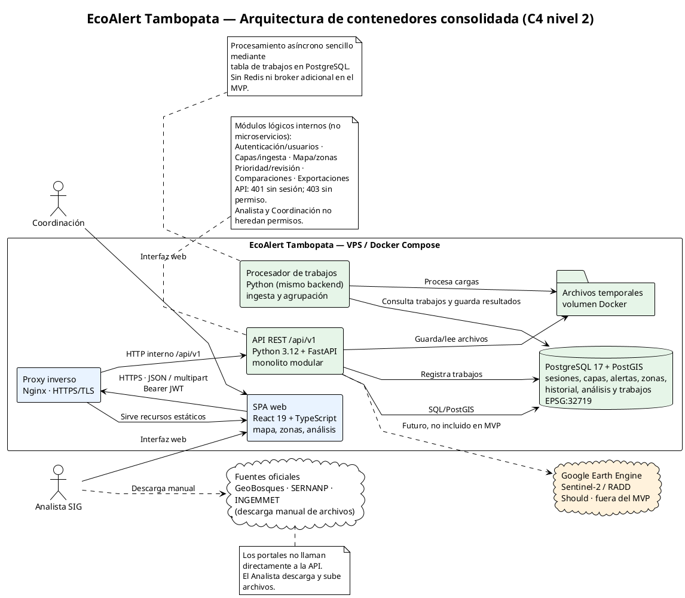

# EcoAlert Tambopata — Arquitectura consolidada del equipo

**Versión:** 1.0 · **Fecha:** 24/10/2026  
**Referencias:** `SRS_equipo.md` (línea base v1.0), `openapi_equipo.yaml`, `diagrama_clases_equipo.puml` y diagramas individuales de MAA, AGGS, DMV y EDSM.

## 1. Acuerdo arquitectónico

Se adopta una **arquitectura cliente-servidor de tres capas**, desplegada con **Docker Compose en un VPS**, con **frontend React 19/TypeScript**, **backend Python 3.12/FastAPI como monolito modular** y **PostgreSQL 17/PostGIS**. La solución cubre prioritariamente los requerimientos **Must (RF-01 a RF-17)**. Se evita introducir microservicios, Redis o integraciones automáticas con portales oficiales en esta versión.

## 2. Comparación de las cuatro propuestas

| Aspecto | MAA | AGGS | DMV | EDSM | Decisión de equipo |
|---|---|---|---|---|---|
| SPA React/TypeScript | Sí | Sí | Sí | Sí | Conservar |
| API FastAPI modular | Sí | Sí | Sí | Sí | Conservar |
| PostgreSQL/PostGIS | Sí | Sí | Sí | Sí | Conservar |
| Dos roles | Sí | Sí | Sí | Sí | Conservar sin herencia |
| Fuente oficial manual | Sí | Sí | Sí | Dibujada como conexión a API | Descarga y carga manual por Analista |
| Proxy inverso | Caddy | No explícito | Nginx | No explícito | Nginx, por simplicidad y consistencia con OpenAPI |
| Trabajos asíncronos | Tareas programadas | No explícito | Worker con tabla en PostgreSQL | Worker + Redis | Worker sencillo + tabla PostgreSQL |
| Archivos temporales | Volumen Docker | No explícito | No explícito | No explícito | Volumen temporal para carga |
| GEE/RADD/Sentinel-2 | No integrado | Should | Should | Should | Fuera del MVP, solo extensión futura |
| Respaldos externos | Sí | No explícito | Sí | No explícito | Operación recomendada, no componente central del MVP |
| GitHub/CI | Sí | No explícito | No explícito | No explícito | Herramienta de desarrollo, fuera del límite funcional del diagrama |

**Consenso:** SPA, API modular, PostGIS, roles Analista SIG y Coordinación, procesamiento de información geoespacial y despliegue centralizado. Las diferencias relevantes son de infraestructura y del tratamiento de cargas y tareas.

## 3. Conflictos y resolución

| ID | Conflicto | Acuerdo y justificación |
|---|---|---|
| ARQ-01 | Caddy vs Nginx vs proxy omitido | **Nginx**. Terminación TLS y encaminamiento `/api/v1`; coincide con el servidor documentado en el OpenAPI consolidado. |
| ARQ-02 | Sin worker vs worker PostgreSQL vs worker Redis | **Worker con tabla de trabajos en PostgreSQL**. El API expone `GET /trabajos/{trabajoId}`; evita un broker adicional. |
| ARQ-03 | Cargas manuales vs flechas fuente→API | **Descarga manual y posterior subida por el Analista**. Ninguna fuente oficial invoca automáticamente al backend en el MVP. |
| ARQ-04 | Tareas programadas vs procesamiento de ingesta | **Separar procesamiento asíncrono de la petición HTTP**. El worker procesa cargas y agrupación; tareas diarias quedan como configuración operativa si se requieren. |
| ARQ-05 | Archivos temporales no representados | **Volumen temporal compartido por API y worker**. Necesario para el flujo `POST /archivos`; política de limpieza configurable, sin imponer límites no acordados. |
| ARQ-06 | Extensiones Should dentro del sistema actual | **GEE, RADD y Sentinel-2 como futuras integraciones**. No constituyen dependencias para los RF-01 a RF-17. |
| ARQ-07 | Cálculo espacial en API vs en base de datos | **PostGIS para consultas/operaciones espaciales persistidas**, con validación y transformación en backend cuando corresponda; almacenamiento y cálculos métricos EPSG:32719, GeoJSON de salida EPSG:4326. |
| ARQ-08 | Diferencias en gestión de sesión | **Autenticación Bearer y validación de sesión/rol en el servidor**, con expiración por inactividad y revocación. No asumir cookie como mecanismo único. |
| ARQ-09 | Respaldo y CI representados como componentes de producto | **Mantenerlos como aspectos operativos**; pueden documentarse aparte sin aumentar la complejidad del diagrama funcional. |

## 4. Diagrama definitivo (PlantUML)

El archivo editable es **`diagrama_componentes_equipo.puml`**. Se reproduce a continuación para que `arquitectura_equipo.md` sea autocontenido:

## 5. Componentes y responsabilidades

| Componente | Responsabilidad | Interfaces principales |
|---|---|---|
| SPA React | UI en español, mapa, listas, detalle, formularios y descargas | HTTPS hacia proxy; sin acceso directo a DB |
| Nginx | TLS, contenido estático y enrutamiento al backend | HTTPS público, HTTP interno |
| API FastAPI | Autenticación, roles, validaciones, reglas de negocio, consultas y exportaciones | REST `/api/v1`, JSON, GeoJSON, CSV, multipart |
| Worker Python | Procesamiento diferido de cargas y agrupación de alertas | Tabla de trabajos PostgreSQL y volumen temporal |
| PostgreSQL/PostGIS | Persistencia de sesiones, capas versionadas, alertas, zonas, cálculos, historial, comparaciones y trabajos | SQL/PostGIS; acceso interno |
| Volumen temporal | Conservación transitoria de archivos subidos para procesamiento | Sistema de archivos interno |

Los módulos de **autenticación/usuarios, capas/ingesta, mapa/zonas, prioridad/revisión, comparaciones y exportaciones** son módulos *dentro de la misma API*, no servicios desplegados por separado.

## 6. Coherencia con `openapi_equipo.yaml`

La arquitectura contempla los **38 métodos HTTP** del contrato consolidado (v1.2.0), agrupados así:

| Módulo lógico | Rutas del contrato |
|---|---|
| Acceso y usuarios | `/auth/sesion`, `/auth/password`, `/usuarios` y `/usuarios/{usuarioId}` |
| Carga y capas | `/archivos`, `/capas-referencia`, `/capas-referencia/{tipoCapa}/versiones`, `/cargas-alertas` y `/cargas-alertas/{cargaId}` |
| Trabajos y alertas | `/trabajos/{trabajoId}`, `/alertas` |
| Mapa y zonas | `/mapa/capas`, `/mapa/capas/{capaMapaId}/elementos`, `/zonas`, `/zonas/{codigo}` |
| Revisión y prioridad | Historial, cambios de estado, ajustes y marcas bajo `/zonas/{codigo}` |
| Comparaciones | `/analisis`, `/analisis/{analisisId}` |
| Exportación | `/exportaciones/zonas` |

**Restricciones transversales:** (1) autorización de Analista SIG y Coordinación aplicada en el backend, con `401`/`403`; (2) los datos de los titulares de derechos mineros no se exponen; (3) no se determina automáticamente la causa de una alerta; (4) las comparaciones guardadas son inmutables; (5) las alertas originales no se eliminan al reagrupar zonas; (6) los criterios `x-acceptance-criteria` permanecen en el OpenAPI y no se duplican como endpoints nuevos.

## 7. Flujo básico

1. El **Analista SIG** obtiene manualmente archivos de GeoBosques o de las fuentes de capas oficiales.
2. Desde la SPA carga el archivo mediante la API; el backend valida la sesión, el rol y el formato.
3. La API conserva el archivo temporal y registra la carga/trabajo en PostgreSQL.
4. El worker procesa los datos, aplica reglas de agrupación, actualiza zonas y conserva trazabilidad.
5. La SPA consulta estado de trabajos, zonas, mapa, prioridad explicada e historial.
6. Usuarios autorizados comparan periodos; el Analista puede exportar CSV y GeoJSON conforme a sus permisos.

## 8. Alcance y validación

La solución se concentra en **RF-01 a RF-17 (Must)**. Las funcionalidades **Should/Could** se dejan como extensiones futuras; en particular, GEE/RADD/Sentinel-2 no se implementan por el solo hecho de aparecer en el diagrama.

**Verificación efectuada (25/10/2026):** `diagrama_componentes_equipo.puml`, el diagrama embebido en este documento y `diagrama_clases_equipo.puml` se renderizaron con PlantUML (imagen oficial `plantuml/plantuml` en Docker) sin errores de sintaxis y se revisaron visualmente. El contrato `openapi_equipo.yaml` v1.2.0 se validó (38 operaciones) y el backend FastAPI parcial (15 operaciones) se ejecutó contra PostgreSQL/PostGIS reales con la suite de `backend/tests`. **No equivale** a haber desplegado esta arquitectura: Docker Compose, Nginx, la SPA y el worker **no están construidos**; solo se usaron un contenedor PostgreSQL/PostGIS y uvicorn en entorno local. Las decisiones de worker, proxy y almacenamiento temporal son acuerdos propuestos para la consolidación, no requisitos textuales del SRS.
