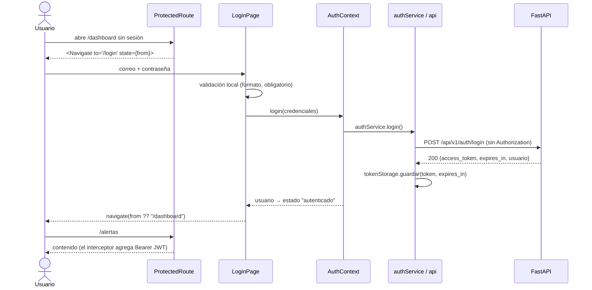

# Capa de servicios de API — decisiones de diseño

**Proyecto:** EcoAlert Tambopata · **Actividad:** S07-S08-A2, Construye | Integración Frontend-Backend
**Entradas:** `S07_S08_A1/decision_stack_frontend.md` (React + Vite + Tailwind + Context API) y el contrato
`backend/docs/openapi_integrado.yaml` v1.3.0 (integra `S05_S06_A1/` y `S05_S06_A2/openapi_equipo.yaml`).
**Código:** `frontend/src/services/`, `frontend/src/context/`, `frontend/src/routes/`, `frontend/src/pages/`.

## 1. Alcance

| Parte | Entregado | Operaciones del contrato |
|---|---|---|
| 1. Capa de servicios | `httpClient` con interceptores, `api` (instancia configurada), `authService`, `alertasService`, `ApiError`, `tokenStorage` | — |
| 2. Autenticación | Página de login, `AuthContext`, `ProtectedRoute`, dashboard protegido; logout mínimo (botón de la Navbar) | `iniciarSesion`, `obtenerSesionActual`, `cerrarSesion` |
| 3. Flujo de negocio | Vista **Alertas** con carga, error con reintento, vacío, filtros y paginación | `listarAlertas` (RF-04) |

Se eligió `GET /alertas` como flujo de negocio porque es el recurso principal ya implementado en el backend, está
abierto a los dos roles (`analista_sig`, `coordinacion`) y está paginado, lo que obliga a manejar parámetros de consulta.
El registro y el cambio de contraseña quedan fuera, como permite el enunciado.

## 2. Arquitectura de la capa

Organización por capas con dependencia en un solo sentido (SWEBOK v4, KA04 *Software Construction*,
"Construction Design"; KA02 *Software Architecture*, estilo en capas). Ningún componente llama a `fetch`.

```mermaid
flowchart LR
  subgraph UI["Vistas (pages/, routes/)"]
    L[LoginPage] --> C
    P[ProtectedRoute] --> C
    A[AlertasPage] --> H[useApiQuery]
  end
  C[AuthContext] --> AS[authService]
  H --> AL[alertasService]
  subgraph S["services/"]
    AS --> API[api.js<br/>instancia + interceptores]
    AL --> API
    API --> HC[httpClient.js<br/>fetch, timeout, ApiError]
    API --> TS[tokenStorage.js]
  end
  HC -->|"/api/v1/*"| PX[Proxy de Vite<br/>(Nginx en producción)]
  PX --> BE[(FastAPI<br/>/api/v1)]
```

| Módulo | Responsabilidad única |
|---|---|
| `config/env.js` | Lee y normaliza `VITE_API_URL` y `VITE_API_TIMEOUT_MS`. |
| `services/httpClient.js` | Fábrica `createHttpClient`: URL + query, interceptores, tiempo máximo, conversión de errores. Sin estado de la app. |
| `services/api.js` | Instancia única configurada con la URL base y los dos interceptores; evento "sesión expirada". |
| `services/apiError.js` | Clase `ApiError` y **tabla única** de mensajes para el usuario. |
| `services/tokenStorage.js` | Guardar, leer (descartando vencidos) y borrar el JWT. |
| `services/authService.js` | `login`, `obtenerSesionActual`, `logout` (tag *Autenticación* del contrato). |
| `services/alertasService.js` | `listar` (tag *Alertas*); traduce camelCase → snake_case del contrato. |

Un módulo por recurso, nombrado como el recurso del contrato, y cada función documenta su `operationId`: la trazabilidad
contrato → código se puede seguir con un `grep` (SWEBOK KA04, "API Design and Use").

## 3. Decisión 1 — Cliente HTTP: `fetch` nativo envuelto en un cliente con interceptores

| Opción | Ventajas | Inconvenientes | Decisión |
|---|---|---|---|
| **`fetch` + envoltura propia** | Sin dependencias; estándar del navegador; `AbortController` nativo | Hay que escribir interceptores, timeout y parseo de errores (≈130 líneas) | **Elegida** |
| axios | Interceptores incluidos; conocido | Dependencia adicional (~13 kB gzip) y superficie de cadena de suministro para algo que el navegador ya trae | Descartada |
| TanStack Query | Caché, reintentos y estado del servidor | Resuelve otro problema (caché); seguiría necesitando un cliente HTTP debajo. Sobredimensionada para un flujo | Pospuesta |

La envoltura reproduce la API de axios (`api.interceptors.request.use`, `api.interceptors.error.use`, `api.get/post/put`),
de modo que migrar a axios después cambia un solo archivo. Cada petición:

1. Construye la URL con `VITE_API_URL` + ruta + parámetros (descarta los vacíos para que el backend aplique sus valores por defecto).
2. Ejecuta los interceptores de solicitud en orden.
3. Serializa el cuerpo a JSON y fija `Accept: application/json, application/problem+json`.
4. Envía con `credentials: 'omit'` (el JWT viaja en `Authorization`, no en cookies: no hay superficie de CSRF) y `cache: 'no-store'`.
5. Corta la petición al superar `VITE_API_TIMEOUT_MS` (15 s por defecto) con `AbortController`.
6. Convierte cualquier fallo en `ApiError`, lo pasa por los interceptores de error y lo lanza.

La cancelación pedida por el componente (desmontaje o cambio de filtros) se propaga como `AbortError` y **no** se muestra
como error: así una respuesta lenta nunca sobrescribe una más reciente (`hooks/useApiQuery.js`).

## 4. Decisión 2 — Interceptores

Ambos se registran una sola vez en `services/api.js`:

```js
// Solicitud: agrega el JWT a toda operación salvo las públicas (solo POST /auth/login).
api.interceptors.request.use((config) => {
  if (config.skipAuth) return config;
  const token = tokenStorage.obtener();          // null si no hay o si venció
  if (token) config.headers.set('Authorization', `Bearer ${token}`);
  return config;
});

// Error: un 401 significa que la sesión ya no sirve (vencida, inactiva > 30 min, revocada, cuenta desactivada).
api.interceptors.error.use((error, config) => {
  if (error.status !== 401 || config.skipSessionHandling) return;
  tokenStorage.limpiar();
  suscriptores.forEach((notificar) => notificar(error));   // AuthContext → estado anónimo → /login
});
```

- **Lista de permitidos para omitir el token, no de bloqueados:** por defecto toda petición lleva el JWT, igual que el backend
  aplica "denegación por defecto" a todo `/api/v1` salvo el login.
- **El login desactiva el manejo de sesión** (`skipSessionHandling`): allí un 401 significa credenciales incorrectas y debe
  mostrarse "Usuario o contraseña incorrectos", no "tu sesión expiró".
- El interceptor de error **no conoce React**: publica un evento (`onSesionExpirada`) al que se suscribe `AuthContext`.
  La capa de servicios se puede probar sin renderizar componentes.

## 5. Decisión 3 — Manejo de errores centralizado

El backend responde los errores como `application/problem+json` (RFC 9457) con `codigo` y `mensaje` obligatorios
(esquema `Error`). `apiError.js` es el **único lugar** que interpreta estados HTTP; los componentes solo muestran
`error.message` con `<ErrorAlert>` (role="alert").

| Situación | `codigo` | Mensaje que ve el usuario |
|---|---|---|
| Sin red, DNS, backend apagado, CORS | `ERROR_RED` | "No se pudo conectar con el servidor. Verifica tu conexión a internet o que el backend esté en ejecución." |
| Backend caído detrás del proxy (502/504, o 5xx sin problem+json) | `HTTP_5xx` | El mismo mensaje de conexión: el error lo generó el proxy, no la API |
| Tiempo agotado | `TIEMPO_AGOTADO` | "El servidor tardó demasiado en responder. Inténtalo de nuevo." |
| 4xx con `mensaje` del contrato | el del backend | El `mensaje` del backend (ya está en español y pensado para el usuario, RNF-06) |
| 403 `CAMBIO_PASSWORD_REQUERIDO` | igual | "Debes cambiar tu contraseña temporal antes de continuar." |
| 429 / 503 | el del backend | Mensaje + "(reintenta en N s)" a partir de `Retry-After` |
| 500 y otros 5xx | el del backend | Genérico: "Ocurrió un error en el servidor…". **El texto interno nunca se muestra** (OWASP: no filtrar detalles de implementación). |
| Cuerpo ilegible o inesperado | `RESPUESTA_INVALIDA` | "El servidor envió una respuesta inesperada…" |

Esto aplica la recomendación de SWEBOK KA04 sobre manejo de errores: decidir la política una vez (convertir, informar,
nunca ocultar) y aplicarla de forma uniforme, en lugar de dispersar `try/catch` con criterios distintos en cada vista.
Los errores de validación del cliente (correo vacío, código de zona con formato inválido) se detectan antes de llamar a la
API con las mismas reglas del contrato (`CodigoZona: ^EA-\d{4}-\d{3}$`), lo que evita un 400 innecesario.

## 6. Decisión 4 — Almacenamiento del token

**Elegido: `sessionStorage` + copia en memoria**, con la hora de expiración calculada a partir de `expires_in`.

| Opción | Persiste al recargar | Riesgo ante XSS | Riesgo CSRF | Cambios en backend | Decisión |
|---|---|---|---|---|---|
| Solo memoria (variable JS) | No (se pierde al recargar) | Bajo | Ninguno | No | Descartada: mala experiencia al recargar |
| `localStorage` | Sí, indefinidamente y en todas las pestañas | Alto: el token sobrevive al cierre del navegador | Ninguno | No | Descartada (OWASP HTML5 Security Cheat Sheet desaconseja guardar identificadores de sesión ahí) |
| **`sessionStorage` + memoria** | Sí, solo en esa pestaña | Medio: legible por un script inyectado mientras la pestaña está abierta | Ninguno | No | **Elegida** |
| Cookie `HttpOnly; Secure; SameSite=Strict` | Sí | Bajo: JavaScript no la lee | Requiere token anti-CSRF | Sí: el backend entrega el JWT en el cuerpo (`SesionCreada.access_token`) y lee `Authorization` | Recomendada para producción (ver §12) |

Medidas que acompañan la elección:

- **Ventana de exposición acotada:** el token se borra al cerrar la pestaña, al vencer (`expires_in`, con 5 s de margen),
  ante cualquier 401 y al cerrar sesión (que además revoca el `jti` en el servidor con `POST /auth/logout`).
- **Mitigación de XSS, la amenaza real para este mecanismo:** React escapa el contenido por defecto y no se usa
  `dangerouslySetInnerHTML`; el build de producción inyecta una **Content-Security-Policy** (`script-src 'self'`,
  `connect-src 'self'`, `object-src 'none'`, `base-uri 'self'`) desde `vite.config.js`.
- **El token nunca se registra** en la consola ni se guarda la contraseña; el campo de contraseña se vacía tras un intento fallido.
- **El frontend no decide la autorización:** `ProtectedRoute` solo mejora la experiencia. El backend valida firma, `exp`,
  `iss`, `aud`, la sesión en base de datos, el rol y el estado de la cuenta en **cada** petición.
- Al recargar con un token guardado, la app no confía en él: llama a `GET /auth/me` antes de mostrar contenido protegido.
- Acceso a `sessionStorage` protegido con `try/catch`: si el navegador lo bloquea, la sesión dura lo que la pestaña.

## 7. Decisión 5 — URL base y comunicación con el backend

- `VITE_API_URL` (en `frontend/.env`, plantilla en `.env.example`) es la URL base e **incluye `/api/v1`**. Por defecto es
  relativa: **`/api/v1`**.
- En desarrollo, el **proxy de Vite** reenvía `/api` a `API_PROXY_TARGET` (por defecto `http://localhost:8000`). Esta
  variable no tiene prefijo `VITE_`, así que se usa solo en Node y **no llega al bundle**.
- En producción, Nginx sirve la SPA y reenvía `/api` al backend (el contrato declara `servers: …/api/v1` detrás de Nginx).
- Resultado: frontend y API comparten origen en ambos entornos y **el backend no necesita habilitar CORS**, que sería
  superficie de ataque adicional. Si un despliegue requiere un origen distinto, basta con una URL absoluta en
  `VITE_API_URL` y una lista de orígenes permitidos en el backend; la CSP agrega ese origen a `connect-src` automáticamente.
- En Codespaces el proxy apunta a `localhost:8000` del mismo contenedor, por lo que solo hay que publicar el puerto 5173.

## 8. Flujo de autenticación (Parte 2)



- **Redirección segura:** solo se vuelve a rutas internas (`/…`, nunca `//…`), lo que evita una redirección abierta.
- **Estados de `ProtectedRoute`:** `verificando` (muestra "Verificando tu sesión…"), `autenticado` (renderiza) y `anonimo`
  (redirige guardando la ruta pedida).
- Si la sesión expira mientras se usa la app, el interceptor de 401 la cierra en toda la aplicación y el login muestra
  "Tu sesión terminó" con el mensaje del backend.

## 9. Flujo de negocio (Parte 3): consulta de alertas

`pages/AlertasPage.jsx` → `useApiQuery` → `alertasService.listar()` → `GET /api/v1/alertas?zona&presente_en_ultima_carga&limite&desplazamiento`.

| Estado | Qué ve el usuario | Accesibilidad |
|---|---|---|
| Cargando | Indicador giratorio y "Cargando alertas desde el servidor…" | `role="status"`, `aria-busy` en la sección |
| Error | Recuadro rojo con el mensaje de `ApiError` y botón **Reintentar** | `role="alert"` |
| Sin resultados | "No hay alertas que coincidan con los filtros." | Texto visible |
| Con datos | Tabla (código, fuente, zona, fecha, área en ha, presencia) + total + paginación de 10 en 10 | `<caption>`, `<th scope="col">`, `aria-live` en el total |

Filtros: código de zona (validado y normalizado a mayúsculas) y presencia en la última carga. Cambiar un filtro reinicia la
página y cancela la petición en curso.

## 10. Verificación

### Puntos solicitados por el enunciado

| Verificación | Evidencia |
|---|---|
| La URL base se lee de `VITE_API_URL` | `src/config/env.js`; `.env.example`; prueba `httpClient.test.js` y `AlertasPage.test.jsx` comprueban la URL `/api/v1/alertas?...` |
| El JWT se almacena de forma segura | §6; prueba "usa sessionStorage y no localStorage" y "descarta un token vencido" |
| Errores de red con mensajes útiles en pantalla | `ErrorAlert` en login y alertas; prueba "traduce un fallo de red en un mensaje útil"; segundo ≈12 de `flujo_e2e.mp4` |

### Pruebas automatizadas (Vitest + Testing Library) — `npm test`

28 pruebas en 4 archivos, todas aprobadas:

| Archivo | Qué verifica |
|---|---|
| `services/httpClient.test.js` (11) | URL y parámetros, interceptores, cuerpo JSON, problem+json 4xx, 5xx sin filtrar detalles, `Retry-After`, error de red, backend caído tras el proxy, timeout, cancelación, interceptor de error |
| `services/authService.test.js` (7) | Login guarda token sin enviar `Authorization`; 401 del login ≠ sesión expirada; JWT en operaciones protegidas; 401 limpia token y notifica; logout limpia aunque falle la red; expiración; `sessionStorage` |
| `routes/ProtectedRoute.test.jsx` (6) | Redirección sin sesión; verificación con `/auth/me`; token rechazado → login con aviso; login redirige a la ruta pedida; validación del formulario; error de credenciales |
| `pages/AlertasPage.test.jsx` (4) | Carga → datos; error de red → reintento; validación y normalización del filtro de zona; estado vacío |

Además: `npm run build` sin errores (CSP presente en `dist/index.html`) y `npm audit --omit=dev` sin vulnerabilidades.
Dependencias nuevas fijadas a versión exacta y con más de dos semanas de publicadas (`react-router-dom@7.18.4`,
`vitest@5.0.5`, `jsdom@30.1.3`, Testing Library).

### Videos

| Archivo | Duración | Contenido |
|---|---|---|
| `flujo_auth.mp4` | 18.8 s | `/dashboard` sin sesión → redirección a `/login` → credenciales → login exitoso → dashboard → otra ruta protegida (`/alertas`) → recarga que conserva la sesión vía `GET /auth/me` |
| `flujo_e2e.mp4` | 18.4 s | Dashboard → `/alertas`: estado de carga → datos reales de PostgreSQL → página 2 → filtro por zona → error de red con feedback y **Reintentar** → datos |

Ambos se grabaron con Playwright (Chromium, 1280×720) contra el frontend y el backend reales en ejecución. Para que el
estado de carga sea perceptible en local, el guion añade **0.7 s de latencia** a las peticiones `/api`; el error de red del
video e2e se **simula** abortando una sola petición. Ambas cosas se indican en el rótulo inferior del video.

## 11. Cómo reproducir

```bash
# Backend (ver backend/README.md): base levantada, .env con JWT_SECRET e IDEMPOTENCY_SECRET
cd backend
python -m scripts.sembrar_demo            # cuenta analista.demo@ecoalert.pe + 6 zonas + 24 alertas (pide contraseña)
python -m uvicorn app.main:app --reload --env-file .env

# Frontend
cd frontend
npm install
cp .env.example .env                      # VITE_API_URL=/api/v1, API_PROXY_TARGET=http://localhost:8000
npm run dev                               # http://localhost:5173
npm test
```

`scripts/sembrar_demo.py` existe porque la ingesta de alertas aún no está implementada en el backend. Es idempotente y se
niega a ejecutarse contra un host no local o contra una base `*_test`.

## 12. Limitaciones y trabajo futuro

| Limitación | Propuesta |
|---|---|
| El JWT es legible por JavaScript mientras la pestaña está abierta | Migrar a cookie `HttpOnly; Secure; SameSite=Strict` emitida por el backend, con token anti-CSRF en peticiones que cambian estado |
| La CSP se entrega como `<meta>` (no admite `frame-ancestors`) | Enviarla como cabecera HTTP desde Nginx junto con `X-Frame-Options: DENY` |
| No hay reintentos automáticos | Reintentar con *backoff* solo operaciones idempotentes (GET) ante `ERROR_RED`/503, respetando `Retry-After` |
| Sin pantalla de cambio de contraseña temporal | Implementar `PUT /auth/password` y redirigir cuando `debe_cambiar_password` sea verdadero (hoy se informa con un aviso) |
| Sin caché de datos del servidor | Evaluar TanStack Query cuando haya varias vistas que compartan datos |

## 13. Referencias

- IEEE Computer Society (2024). *SWEBOK Guide v4.0a*, cap. 4 *Software Construction* (diseño para la construcción, manejo de errores, uso de APIs, pruebas en la construcción) y cap. 13 *Software Security*.
- OWASP. *HTML5 Security Cheat Sheet* (almacenamiento local) y *REST Security Cheat Sheet*.
- IETF. RFC 9457 *Problem Details for HTTP APIs*; RFC 6750 *Bearer Token Usage*.
- W3C (2023). *WCAG 2.1*, criterios 1.3.1, 3.3.1 y 4.1.3.
